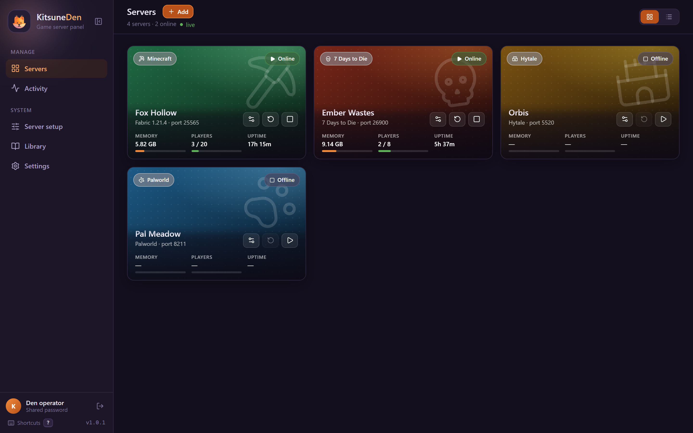
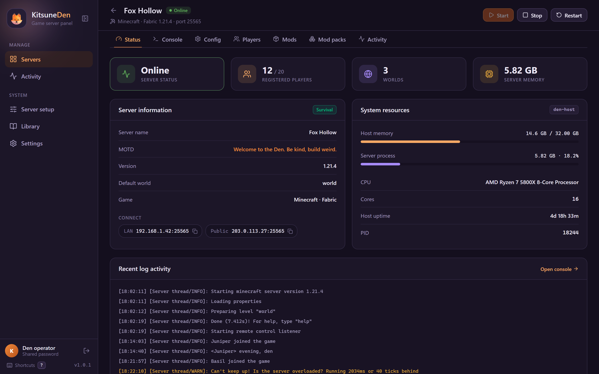
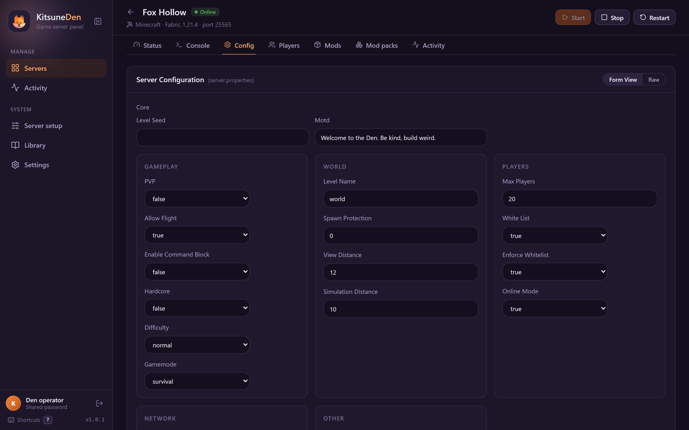
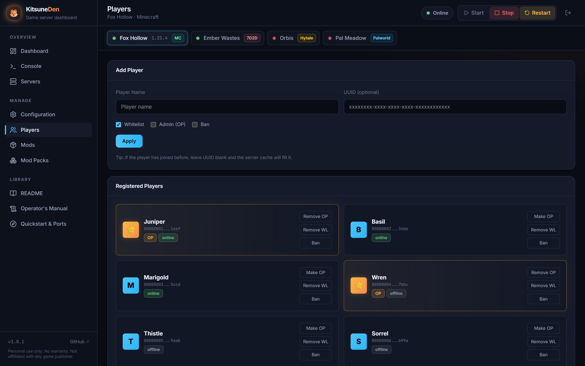
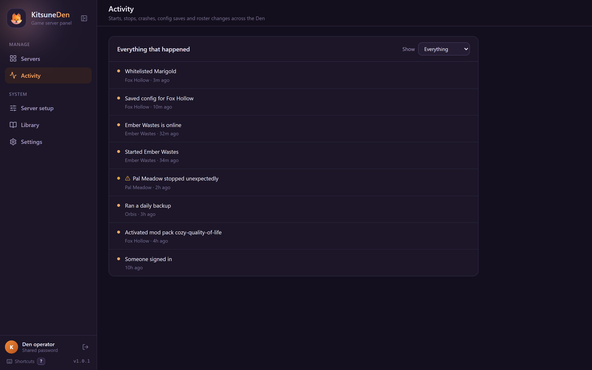
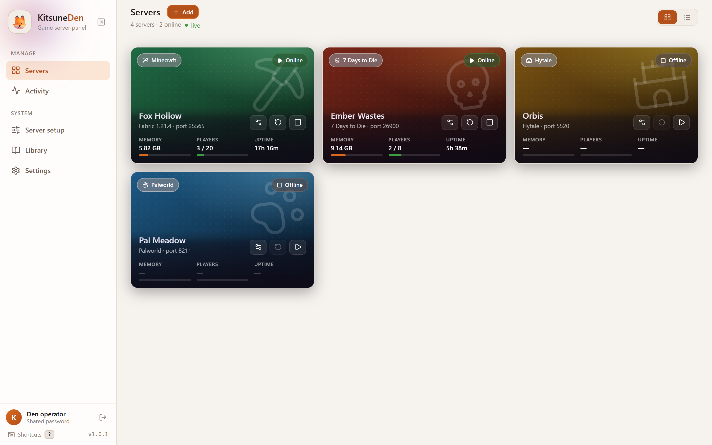

# 🦊 KitsuneDen

[](https://github.com/Kitsune-Den/KitsuneDen/actions/workflows/test.yml)
[](https://github.com/Kitsune-Den/KitsuneDen/actions/workflows/build.yml)
[](https://opensource.org/licenses/MIT)
[](https://nodejs.org)
[](https://github.com/Kitsune-Den/KitsuneDen)
[](src/den-operators-manual/00-preface.md)
[](https://en.wikipedia.org/wiki/Coffee)

A warm, unified dashboard for the game servers you run at home.

KitsuneDen treats your servers like living things. Each one gets its own personality, its own logs, its own spot in the Den. It's built for the person who runs a Minecraft server for their friends, a 7 Days to Die world for the weekend, and a Palworld box nobody's touched since March, and wants one clean place to keep an eye on all of it.



---

## What it does

- **Every server at a glance.** A grid of server cards with live status, memory, players online and uptime, plus quick start/stop/restart.
- **Add servers from the UI.** Pick a game, browse to the install folder, fill in the ports. No hand-editing JSON unless you want to.
- **A page per server.** Status, console, config, players, mods, backups and more as tabs, each with its own URL.
- **Live console** with command input and history.
- **Players.** Whitelist, op, ban, kick, plus who's online right now (via RCON for Minecraft and Palworld, telnet for 7D2D).
- **Mods and mod packs.** Upload, organize, and flip whole sets on.
- **Config editor** with friendly widgets where they help (the 7D2D day/night slider is the favorite). Edits are staged: changed fields are marked until you save, and it offers a restart when one's needed.
- **Worlds, backups, and updates** for the games that support them: SteamCMD for Palworld and Enshrouded, the launcher for Hytale.
- **Remote Minecraft.** The dashboard and the server don't have to share a machine. See [Remote Minecraft servers](#remote-minecraft-servers).
- **Activity log.** Starts, stops, crashes, config saves and roster changes, for one server or the whole Den.
- **Dark, light, or match your OS**, plus a colour-blind friendly status palette.
- **Keyboard shortcuts.** `s` / `x` / `r` to start, stop and restart, `[` `]` to flip tabs, `?` for the full list.
- **A password at the door.** One shared password keeps randos off your dashboard.

| A server's page | Staged config editing |
|---|---|
|  |  |
| **Players** | **Activity** |
|  |  |
| **Light theme** | |
|  | |

<sub>Screenshots use demo data. Those aren't real players or real IPs.</sub>

---

## Supported games

| Game | Type | Status |
|------|------|--------|
| Minecraft (Fabric, NeoForge, Vanilla, most other loaders) | `minecraft` | ✅ Full support, local or remote |
| 7 Days to Die | `7d2d` | ✅ Full support |
| Hytale | `hytale` | ✅ Full support |
| Palworld | `palworld` | ✅ Full support |
| Enshrouded | `enshrouded` | ✅ Full support (no RCON, so no live commands) |
| Something else | - | 🔧 [Write an adapter](#adding-a-new-game) |

---

## Getting started

### Prerequisites

- [Node.js](https://nodejs.org/) 20.9 or newer (Next.js 16 needs it)
- Your game server(s), installed and runnable

### Install

```bash
git clone https://github.com/Kitsune-Den/KitsuneDen.git
cd KitsuneDen
npm install
```

### Set the password

KitsuneDen won't let anyone in until you give it a password and a session secret.

```bash
cp .env.example .env
```

Then open `.env` and fill in real values:

| Variable | What it is |
|---|---|
| `KITSUNEDEN_PASSWORD` | The shared password. Everyone you let into the Den knows this one. |
| `KITSUNEDEN_SESSION_SECRET` | HMAC key for signing session cookies. 32+ random characters. `openssl rand -base64 48` works. |

If either one is missing, the login page shows a setup banner instead of a password box and the API answers `503`. Sessions last 7 days. Rotating the secret logs everyone out, which is exactly what you want if the password leaks.

The session cookie is only marked `Secure` when the request came in over HTTPS (directly, or through a proxy or tunnel that sets `X-Forwarded-Proto: https`), so signing in over plain `http://<LAN-IP>:3001` works.

It's a shared password, so there's no per-user audit trail, and changing it means telling everybody. Fine for a home dashboard. If you ever need real accounts, the gate is built so they can slot in without changing the cookie shape.

### Add your servers

The easy way: start the Den, open **Servers**, click **Add Server**.

Or copy the example and edit it by hand:

```bash
cp servers.example.json servers.json
```

Field details are under [Configuration](#configuration).

### Run it

```bash
npm run dev       # development, with hot reload
npm run build     # production build
npm run start     # production server
npm test          # the test suite
```

Then open `http://localhost:3001`. The port lives in the `dev` and `start` scripts in `package.json` if you want a different one.

---

## Configuration

`servers.json` is the Den's map: where each server lives and how to talk to it. The dashboard edits it for you, but it's plain JSON if you'd rather.

```json
{
  "servers": [
    {
      "id": "fabric",
      "name": "Fabric",
      "type": "minecraft",
      "dir": "C:\\GameServers\\fabric-server",
      "loader": "Fabric",
      "version": "1.21.4",
      "jar": "fabric-server-launch.jar",
      "launchMode": "jar",
      "gamePort": 25565,
      "rconPort": 25575,
      "rconPassword": "your-rcon-password"
    }
  ]
}
```

`servers.example.json` has fuller examples, including NeoForge (argfile launch), Hytale, 7 Days to Die, and Palworld.

By default KitsuneDen reads and writes `servers.json` in the directory it's started from. Set `KITSUNEDEN_SERVERS_CONFIG` to an absolute path to use a different file instead — the dashboard's add/edit/remove server actions write back to that same file. The test suite uses this to work on a temp copy, so running `npx vitest run` never touches your live config.

### Fields by game

**`minecraft`**: Fabric, NeoForge, Vanilla, and most other loaders

| Field | Required | Description |
|-------|----------|-------------|
| `dir` | ✅ | Path to the server directory |
| `jar` | For jar mode | Server jar filename |
| `launchMode` | ✅ | `"jar"` or `"argfile"` |
| `argFiles` | For argfile mode | JVM arg files (NeoForge) |
| `javaPath` | Optional | Full path to the java executable |
| `gamePort` | ✅ | Port players connect to |
| `rconPort` | Optional | RCON port for commands |
| `rconPassword` | Optional | RCON password |
| `rconHost` | Optional | Machine the server runs on. Defaults to `127.0.0.1`. Setting it makes the server remote. |
| `lifecycle` | Optional | SSH settings for starting a remote server. See below. |

**`7d2d`**: 7 Days to Die

| Field | Required | Description |
|-------|----------|-------------|
| `dir` | ✅ | Path to the server directory |
| `configFile` | Optional | Config XML filename |
| `telnetPort` | Optional | Telnet port |
| `telnetPassword` | Optional | Telnet password |
| `modsDir` | Optional | Mods directory name |

**`hytale`**: Hytale

| Field | Required | Description |
|-------|----------|-------------|
| `dir` | ✅ | Path to the server directory |
| `startScript` | Optional | Startup bat/script |
| `backupScript` | Optional | Backup script, relative to `dir` |
| `processFilter` | Optional | Process name filter |
| `gamePort` | ✅ | Port players connect to |

**`palworld`**: Palworld

| Field | Required | Description |
|-------|----------|-------------|
| `dir` | ✅ | Path to the server directory |
| `steamCmdPath` | Optional | Path to steamcmd.exe for updates |
| `gamePort` | Optional | Game port (default 8211) |
| `rconPort` | Optional | RCON port (default 25575, so pick another if Minecraft is using it) |
| `rconPassword` | Optional | RCON password |
| `restApiPort` | Optional | REST API port (default 8212) |
| `restApiPassword` | Optional | REST API password |

**`enshrouded`**: Enshrouded

| Field | Required | Description |
|-------|----------|-------------|
| `dir` | ✅ | Path to the server directory |
| `startScript` | Optional | Startup bat (falls back to `enshrouded_server.exe`) |
| `configFile` | Optional | Config filename (default `enshrouded_server.json`) |
| `steamCmdPath` | Optional | Path to steamcmd.exe for updates (Steam app id 2278520) |
| `gamePort` | Optional | UDP game port (default 15637) |
| `queryPort` | Optional | UDP Steam query port (default 15638) |

> Enshrouded ships no RCON or REST API, so live commands aren't available.
> Player presence is a best guess, scraped from connect/disconnect lines in the log.

### Remote Minecraft servers

The Den doesn't have to live on the same box as your Minecraft server. Set `rconHost` to the server's address and KitsuneDen talks to it over the network. Status comes from probing the game port. The console, stop, and player changes (op, whitelist, ban) all go through RCON.

Starting a server that isn't running is the one thing RCON can't do. For that, add a `lifecycle` block and the Den will SSH in and run your start command:

```json
{
  "id": "survival",
  "name": "Survival",
  "type": "minecraft",
  "dir": "C:\\GameServers\\survival-stub",
  "rconHost": "192.168.1.60",
  "rconPort": 25575,
  "rconPassword": "your-rcon-password",
  "gamePort": 25565,
  "lifecycle": {
    "kind": "ssh",
    "host": "192.168.1.60",
    "user": "minecraft",
    "identityFile": "C:\\Keys\\kitsuneden_ed25519",
    "startCommand": "Start-ScheduledTask -TaskName 'Minecraft Survival'"
  }
}
```

| Field | Description |
|-------|-------------|
| `kind` | Always `"ssh"` for now |
| `host` / `user` / `port` | Where to connect (`port` defaults to 22) |
| `identityFile` | Private key on the dashboard machine. Whatever account runs KitsuneDen has to be able to read it. |
| `startCommand` | PowerShell run on the remote host for start and restart |
| `stopCommand` | Accepted, but not used yet. Stop always goes through RCON. |

Heads up: `startCommand` is arbitrary PowerShell, and it runs with whatever rights the SSH user has. Treat `servers.json` like a file that can run code on that machine, because it can. Keep write access to admins and give the SSH user only what it needs. The dashboard won't let anyone set or change `lifecycle` from the UI or the API; it can only be set in `servers.json`, and the API never sends it (or any password) back to the browser.

Without a `lifecycle` block, a remote server can still be stopped and managed. The Den just refuses to start it and tells you to use your own launcher.

---

## Adding a new game

KitsuneDen uses adapters. Every game is one class that implements the `ServerAdapter` interface.

1. Create `src/lib/adapters/your-game-adapter.ts`
2. Implement `ServerAdapter` from `types.ts`
3. Register it in `adapter-registry.ts`
4. Add the type to `ServerDefinition` in `types.ts`, and a label and color in `src/lib/game-meta.ts`

The interface covers lifecycle (start/stop/restart), logs, stats, config, and players. Implement what your game supports. Capability flags tell the UI which pages to show:

```ts
export const capabilities: ServerCapabilities = {
  hasRcon: false,
  hasMods: true,
  hasModPacks: false,
  hasBackups: true,
  hasWorlds: true,
  hasWarps: false,
  hasServerProperties: false,
  hasJsonConfig: true,
  hasKitsuneCommand: false,
  hasRestApi: false,
  hasSteamUpdate: false,
  hasLauncherUpdate: false,
};
```

---

## Auto-start on Windows

KitsuneDen is happiest as a scheduled task. Antivirus tends to get twitchy about `.bat` files in the startup folder.

1. Build once: `npm run build`
2. Open **Task Scheduler** and create a task:
   - **Trigger:** At startup, with a 30 second delay
   - **Action:** Start a program. Program: `cmd.exe`. Arguments: `/c npm run start`. Start in: your KitsuneDen folder.
   - **Run with highest privileges**
   - **Restart on failure**
3. Run it by hand once before you trust it to come up on its own.

The [Operator's Manual](src/den-operators-manual/07-appendices.md) has more on running it as a service.

---

## The Den

KitsuneDen has a philosophy: your servers aren't cold infrastructure, they're creatures worth tending. Dashboards are companions. Logs are journals. Ports are doorways.

The [Operator's Manual](src/den-operators-manual/00-preface.md) covers the Den's architecture, its spirits (one per game), day-to-day operations, and what to do when things break. It's also readable inside the dashboard, under **Library**.

The panel's look and layout borrow from [PackRelay](https://pack-relay.com), in the fox's colours.

---

## Stack

- [Next.js](https://nextjs.org/) 16 (App Router, TypeScript)
- [Tailwind CSS](https://tailwindcss.com/) 4
- [Lucide](https://lucide.dev/) icons
- [better-sqlite3](https://github.com/WiseLibs/better-sqlite3) for the bits that need a database
- [rcon-client](https://github.com/janispritzkau/rcon-client) for RCON
- [Vitest](https://vitest.dev/) for tests

---

## Contributing

Pull requests welcome. If you've written an adapter for a new game, please share it. The Den grows when more spirits join.

---

## License

MIT
